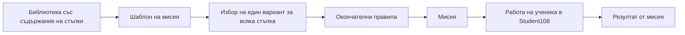

# Edu108

Документация на проекта Edu108: как учителят подготвя **шаблон на мисия**, как от него се съставя конкретна **мисия** и как Student108 използва съдържанието и правилата ѝ.

## Откъде да започна

| Документ | Какво описва |
|---|---|
| [Инсталиране и Windows мрежа](docs/installation/README.md) | Глобална инсталация/обновяване на Student108 чрез Classroom108, WinRM, имена, права и защитна стена. |
| [Утвърдени термини](docs/terminology.md) | Приетите названия на български и английски и точният им смисъл. |
| [От шаблон до мисия](docs/generation.md) | Последователността на работа: библиотека, варианти, избор и заместване на правила. |
| [Публикуване и лични мисии](docs/publishing.md) | Получатели, случайни варианти, лична опашка, съхраняване, доставка и свързване на резултатите. |
| [JSON на шаблон на мисия](docs/mission-template-json.md) | Полетата на шаблона, описанието, стъпките и връзките към вариантите. |
| [JSON Schema за шаблон v1](schemas/mission-template-v1.schema.json) | Машинно описание на допустимите полета и типове за `template_version: 1`. |
| [JSON на мисия](docs/mission-json.md) | Схема 4, `mission_content`, `mission_rules`, `step_content` и `step_rules`. |
| [Правила — Rules](docs/rules.md) | Всички поддържани параметри, стойности по подразбиране, време, разбъркване, жокери и игра. |
| [Типове стъпки](docs/step-types.md) | Информация, свободен отговор, избор на един или няколко отговора и предаване на файл. |
| [Типове мисии](docs/mission-types.md) | Стандартна мисия и „Стани богат“. |
| [Примерни JSON файлове](examples/README.md) | Два стандартни шаблони, JSON шаблон „Стани богат“, примерна библиотека и конкретни мисии за зареждане в Student108. |

Препоръчителен ред: **термини → от шаблон до мисия → JSON описания → правила → примери**.

## Основната връзка

Шаблонът „Хардуер и софтуер“ в примерите има 5 варианта за първата стъпка и 6 за втората: **30 възможни комбинации**, всяка с две конкретни стъпки.

## Какво вече работи

- Teacher108 има **„Wizard 1 Създаване на шаблон за мисия“**, за стандартни шаблони с автоматичен `template_type: "standard"`, отделна библиотека и правила по подразбиране.
- **„Мисии“ → „Import JSON…“** в лявото меню добавя шаблон от файл или поставен текст. Шаблони се приемат и чрез **`POST /template?pin=…`** с шестцифрен пин на вписания учител, валиден 24 часа или до генериране на нов. Стандартът е `template_version: 1`, със задължителен `template_type`. Стандартните шаблони се записват по стъпки, а `millionaire` — като цял JSON след проверка на общото описание.
- **„Мисии“ → „Шаблони на мисии“** показва отделни списъци за двата типа. Само стандартните се отварят в Wizard 1; „Стани богат“ има преглед и копиране на целия JSON.
- Student108 и Teacher108 използват **JSON схема 4 за мисия**. Старият плосък формат не се приема.
- **„Мисии“ → „Публикуване на мисия“** генерира отделна мисия от стандартен шаблон за всеки избран ученик, със случайни варианти и замествания на правилата. Student108 получава най-старата неприключена лична мисия; крайният резултат се свързва с нея.
- Мисията използва `mission_version: 4`, няма `revision` и не се редактира. Променя се шаблонът и се генерира нова мисия с ново `mission_id`.
- Student108 изпълнява правилата за навигация, разбъркване на отговори, време, междинни резултати, жокери и „Стани богат“.
- При ръчно преминаване без отговор се иска потвърждение. При изтекло време преминаването е автоматично, включително при празен отговор.

## Какво предстои

Предстоят правила за подреждане и избор от личния списък, включително по предмет и текущ учебен час. Засега се подава най-старата неприключена мисия по реда на публикуването.

Wizard 1 работи само със стандартни шаблони. Импортът приема и двата типа. Редакторът, пълната игрова валидация и генерирането от JSON шаблони „Стани богат“ предстоят. Файловият експорт още предстои. Шаблоните не се отварят като мисии в Student108. `allow_ai_hint` се пази като правило; реалната AI помощ за ученика предстои.

## Приложения и основа на документацията

- [Teacher108](https://github.com/martin-lift/Teacher108) — подготовка на учебно съдържание, шаблони, мисии и получаване на резултати.
- [Student108](https://github.com/martin-lift/Student108) — работа на ученика по получена мисия.
- [Classroom108](https://github.com/martin-lift/Classroom108) — приложение за класната стая.

Документите и примерите са сверени на **2 ноември 2026 г.** с [Student108 `05b0652`](https://github.com/martin-lift/Student108/commit/05b0652) и [Teacher108 `d905ed9`](https://github.com/martin-lift/Teacher108/commit/d905ed9). Това хранилище съдържа документация и измислени учебни примери, без ученически резултати, акаунти или локални бази.

Проверка при бъдеща редакция: [scripts/validate_examples.py](scripts/validate_examples.py). При съседни изтеглени хранилища `Student108` и `Teacher108` изпълни `python scripts/validate_examples.py` от кореновата папка на това хранилище. Скриптът проверява примерите с реалните валидатори, импортира шаблоните само във временна база и проверява JSON фрагментите и локалните връзки.

За проверка и през публикуваната JSON Schema: инсталирай пакета `jsonschema` в работната среда и изпълни `python scripts/validate_examples.py --json-schema`. Самият Teacher108 не изисква този пакет — използва валидатора с подробни съобщения на български.
